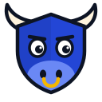
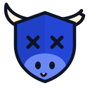
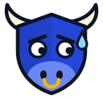
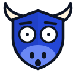
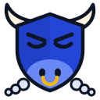
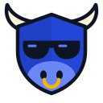

# The bull

RektBull's mascot and logo. **The head is the shield** (the site's original
mark), with horns on top and the snout and gold nose ring at its point: a
safety brand with a character. The calm face is the logo; the other faces are
reaction images for posts, the site and the newsletter.

Everything is drawn in code, so it stays consistent and can be changed in one
place:

- [`bull.js`](bull.js) draws the bull (`bull(mood)`) and the small mark (`mark()`).
- [`render.js`](render.js) writes every file from it: `node brand/render.js`
  (needs Playwright). Commit what it writes. After the Snap's icon changes, run
  `cd snap && npm run build` so its manifest's checksum matches.
- `test/brand.test.js` fails if a committed file no longer matches the code.

## The faces

| Face | File | Use it for |
|---|---|---|
|  **Calm** | `bull-calm` | The logo. Launches, the profile picture, anything official |
|  **Rekt** (X-eyes, horn snapped) | `bull-rekt` | Hack news, "didn't check, got rekt", our own outages |
|  **Sweating** | `bull-sweating` | Risky approvals, "me after signing…", gas fees |
|  **Shook** | `bull-shook` | A token that can't be sold, a depeg, a big number; the 404 page |
|  **Steaming** | `bull-steaming` | Bull markets, launches, "let's go", always with a nudge to check first |
|  **Shades** | `bull-shades` | "Checked my wallet first", revoked in time, a clean checkup |

**Formats:**
- **Plain SVG** (`public/brand/bull-<face>.svg`): for light backgrounds.
- **Sticker** (`-sticker.svg`, and the 512 px PNGs in `public/brand/stickers/`): has a white border and works on any background, including dark ones and photos. Use it for posts.
- **Small mark** (`public/brand/mark.svg`): for the favicon, the header and anything under 48 px. It's the head without outlines thin enough to blur.

They're served at `https://rektbull.com/brand/…`, so they can be linked as well
as downloaded.

## Memes

Ready-made 1080 × 1080 posts are in [`memes/`](memes), one per face. Their
captions live in `render.js` (`MEMES`): change the words there, and run it
again.

| File | Caption |
|---|---|
| `dont-get-rekt.png` | Don't get rekt. / Check your wallet first: rektbull.com |
| `unlimited-approval.png` | Me after approving unlimited USDC / to a contract I can't name |
| `cant-sell.png` | When the token you bought / can't be sold |
| `didnt-check.png` | Didn't check the approvals. / Got rekt. |
| `checked-first.png` | Revoked my old approvals / before the hack news hit |
| `bull-market.png` | Bull market energy / Still checking every signature |

## Rules

1. **Laugh at ourselves and at the attack, never at the people hit.** After a
   hack, the rekt face goes with "here's how it worked, check yours", never
   with a victim's name, address or loss as the joke.
2. **The faces never make a safety claim.** Shades means "I checked", not "it's
   safe". No meme says a token, dapp or campaign is safe, and none promises
   returns (see [POSITIONING.md](../docs/POSITIONING.md)).
3. **Don't redraw it by hand.** Change `bull.js` and render, so every size and
   format stays the same bull.
4. **Keep its colours:**
   - Brand blue `#2346d6`, with the lighter snout `#6a88f5`.
   - Cream horns `#fff4dd`.
   - Gold ring `#f5b700`.
   - Ink outlines `#0d1424`.
5. **It's ours.** The bull is an original character, not a remix of an
   existing meme, so RektBull owns it outright. Keep it that way: don't paste
   the bull onto other people's characters in official posts.
